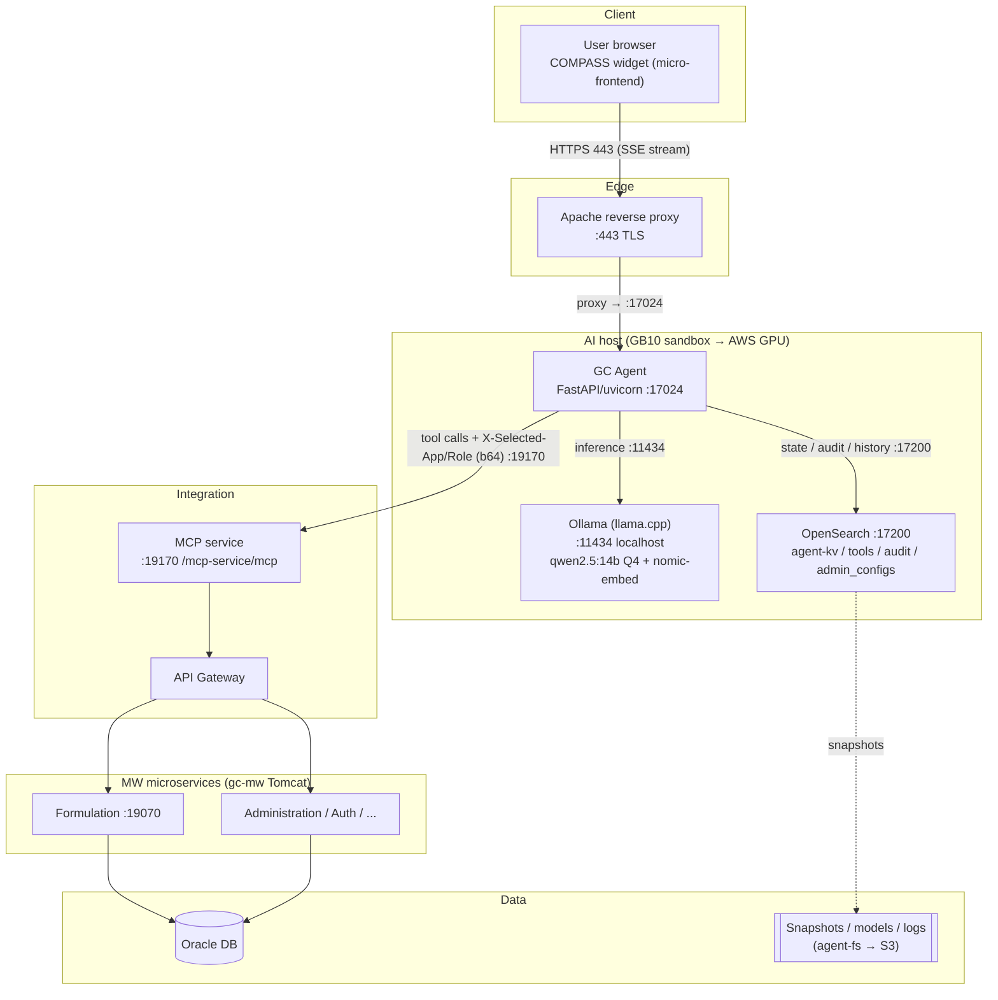

# GC Agent — Technical Setup & Deployment

Scope: the **GC Agent** (the AI assistant embedded in COMPASS) — its runtime stack, the current
sandbox deployment, and the target **AWS air-gapped** deployment (sizing, network, security,
provisioning). Complements [`DEPLOYMENT.md`](DEPLOYMENT.md) (deploy mechanics) and
[`PLATFORM-WIRING.md`](PLATFORM-WIRING.md) (platform integration).

Status: 2026-10-15. Endpoints below verified on the sandbox host.

---

## 1. What the GC Agent is

A FastAPI/Python service that answers user questions and runs guided workflows inside COMPASS
(users, roles, applications, licenses, and the Formulation **baseline** workflows). It uses a
**self-hosted, open-weights LLM** for reasoning and a deterministic tool layer (MCP) for all live
data and mutations. No external/metered LLM API is used.

---

## 2. The model + engine stack (and the "llama" naming clarification)

Three distinct layers — the word *llama* appears in two unrelated places, so they are called out
explicitly:

| Layer | What it is | Current value | License / origin | Compliance concern |
|---|---|---|---|---|
| **Model** (the "brain") | the trained weights that generate text | **qwen2.5:14b** (Q4, 8k ctx) + `nomic-embed-text` (embeddings) | Qwen = Apache-2.0 **but Chinese-origin** | **Yes — the model is the thing to replace** |
| **Engine** | the inference runtime that executes a model | **Ollama**, built on **llama.cpp** | MIT, community/US | No — origin-neutral, model-agnostic |
| **Hardware** | the GPU/CPU | GB10 (sandbox) → AWS GPU (target) | — | — |

- **Meta's Llama model is NOT in use.** The only live "llama" is `llama.cpp` (the engine Ollama is
  built on) — a general engine that runs any model family. A dormant `llama3.1` blob exists in the
  Ollama store from testing but is unreferenced.
- `qwen2.5:14b` means: **Qwen** family, **14 billion** parameters, **Q4** = 4-bit quantization
  (~9 GB on GPU vs ~28 GB at fp16), **@ 8k** = 8192-token context window (`LLM_NUM_CTX=8192`).

### 2.1 Model compliance swap (Qwen → permitted open-weights)

Qwen is restricted in some client environments (Chinese-origin). The fix is a **model swap only** —
the engine (Ollama/llama.cpp) and the rest of the stack are unchanged (`LLM_MODEL=<new>`). All
candidates are self-hosted → **non-priced** (no per-token/license fee; only the GPU costs).

| Candidate | Origin | Size | License | Notes |
|---|---|---|---|---|
| **IBM Granite 3.3 8B** | IBM (US) | 8B | **Apache-2.0** | built for governed/enterprise agentic + RAG; small blob (air-gap friendly) |
| **Mistral Nemo 12B** | Mistral (FR) | 12B | **Apache-2.0** | closest drop-in for qwen-14B; 128k ctx |
| Mistral Small 3.2 24B | Mistral (FR) | 24B | **Apache-2.0** | exceeds 14B; needs L40S for concurrency |
| Phi-4 14B | Microsoft (US) | 14B | **MIT** | exact size; validate tool-calling |
| Llama 3.1 8B | Meta (US) | 8B | Llama Community (free, *not* OSI) | best tool-calling of the free set, but restricted license |

**Decider:** the agent is tuned to Qwen's tool-calling quirks ("slim-schema trick" to fire
mutations). Any swap must **re-pass the eval suite** (`router_eval`, `flow_breakout_eval`, baseline
walk) to confirm MCP mutations fire reliably. That validation — not infra — is the real work.

### 2.2 Engine options: Ollama vs vLLM

| | **Ollama / llama.cpp** (current) | **vLLM** (production-scale) |
|---|---|---|
| Built for | local/dev/edge, air-gap simplicity, low concurrency | high-throughput production serving |
| Concurrency | modest | **continuous batching + PagedAttention** → many more sessions/GPU |
| Quantization | GGUF Q4/Q5/Q8 (low VRAM) | fp16/bf16, AWQ/GPTQ/FP8 (more VRAM, faster) |
| Air-gap staging | 1 binary + 1 GGUF blob | Python + CUDA + weights (heavier) |
| API | Ollama REST + OpenAI-compatible | OpenAI-compatible |

**Recommendation:** keep **Ollama** for sandbox / air-gap-minimal / low load; evaluate **vLLM** for
the production concurrency tier (more concurrent users per GPU → lower $/user). Switching is pointing
`LLM_PROVIDER` at vLLM's OpenAI-compatible endpoint, not a rewrite.

---

## 3. Current sandbox deployment (verified endpoints)

Single host `192.168.0.180` (GB10, 20 ARM cores, 128 GB unified memory, 3.7 TB disk):

| Component | Bind | Notes |
|---|---|---|
| Reverse proxy (Apache) | `:80`, `:443` | serves the COMPASS widget + proxies `/ai-service`, `/gc-agent`, `/formulation` |
| **GC Agent** (FastAPI/uvicorn) | `0.0.0.0:17024` | supervisor program `ai-agent-service`; deploy via `deploy/pull-deploy.sh` |
| **Ollama** (inference) | `127.0.0.1:11434` | localhost-only; qwen2.5:14b Q4 + nomic-embed; `OLLAMA_KEEP_ALIVE=-1` keeps model hot |
| **OpenSearch** (state/audit) | `:17200` | indices `agent-kv`, `agent-tools`, `admin_configs`, `agent-audit`; snapshot repo `agent-fs` |
| **MCP service** (tool bridge) | `http://sparkbee-mw.proounce.ai:19170/mcp-service/mcp` | `JAVA_MCP_BASE_URL`; agent→MCP→gateway→MW services |
| Formulation MW (Tomcat) | `:19070` | gc-mw.service (baseline/IOP/budget APIs) |

### 3.1 Request flow
1. Browser (COMPASS micro-frontend widget) → **Apache `:443`** (TLS).
2. Apache → **GC Agent `:17024`** — chat streams over SSE (`/ai-service/{agent}/reply/stream`).
3. GC Agent → **Ollama `:11434`** (local) for inference; → **OpenSearch `:17200`** (local) for
   session/flow state, history archive, and audit.
4. GC Agent → **MCP `:19170`** for every live read/mutation — forwards `X-Selected-App` /
   `X-Selected-Role` (base64) so backend calls are correctly scoped.
5. MCP → **API Gateway** → **MW microservices** (Formulation `:19070`, Administration, Auth, …) →
   **Oracle DB**.

See the network diagram: [`gc-agent-network-diagram.svg`](gc-agent-network-diagram.svg) (and the
Mermaid source in §6).

---

## 4. Target AWS deployment (air-gapped)

### 4.1 Compute sizing
Token generation is **memory-bandwidth-bound**; size by VRAM (fit model + KV cache) and bandwidth,
then by **concurrent generations** (not raw sessions).

| Instance | GPU / VRAM | Fit | ~14B-class gen | On-demand (us-east/GovCloud approx) |
|---|---|---|---|---|
| **g5.2xlarge** ⭐ | A10G / 24 GB | 8–14B Q4 + OpenSearch co-located | ~40–55 tok/s | ~$1.21/hr (~$885/mo) |
| g6.xlarge | L4 / 24 GB | budget | ~20–30 tok/s | ~$0.81/hr |
| g6e.xlarge | L40S / 48 GB | 24B or high concurrency | ~60–90 tok/s | ~$1.86/hr |

- **KV cache** ≈ 1.5 GB per full-8k stream (14B). A10G 24 GB holds ~8 streams by VRAM, ~4
  concurrent *generations* at ≥12 tok/s each by throughput → **throughput, not VRAM, is the limit**
  on Ollama. **vLLM raises this substantially** (continuous batching).
- **Scale out** for concurrency: the app is stateless (state in OpenSearch), so run **N identical
  GPU boxes behind the gateway**; move OpenSearch to a shared node. Size GPU count to peak
  *concurrent generations* with a request queue (`OLLAMA_MAX_QUEUE` / vLLM) absorbing bursts —
  **not** one GPU per licensed seat.
- **Cost:** a 1-yr Compute Savings Plan on g5.2xlarge ≈ ~$560/mo all-in (incl. 300 GB gp3). Avoid
  Spot (resident model → cold-reload pain). No model/licensing cost — the model is free.

### 4.2 Measuring the real concurrency (before committing GPU count)
- **Demand:** smarthub `UserSession` (`loginTime`/`logoutTime`/`lastActiveOn`/`isLogged` per
  `userId`) → compute peak concurrent sessions; filter to agent-licensed users.
- **Cost/turn:** the agent's own `agent-audit` / Metrics (prompt/completion tokens, gen duration →
  tok/s, GPU/CPU) → arrival rate λ, service time S, active fraction.
- Size GPUs with Little's Law (`L = λ·S`) + a queueing target (e.g. p95 wait < 1s). If sandbox
  traffic is thin, derive S from a short **load test** and λ from real smarthub sessions.

### 4.3 Network (isolated / GovCloud)
- VPC with **no Internet Gateway / no NAT**. AWS service access only via **VPC endpoints /
  PrivateLink** (S3, ECR, CloudWatch, SSM).
- Ingress: internal only — front the agent behind the existing gateway/proxy; **no public ALB**.
- Access: **SSM Session Manager** (over endpoint) or bastion; no public SSH.
- Internal ports stay SG-internal/localhost: Ollama `:11434` localhost, OpenSearch `:17200` SG-only,
  agent `:17024` reachable only from the proxy SG.
- Confirm **GPU instance availability in the target region** (g5 is in GovCloud-West; g6e varies).

### 4.4 Air-gap provisioning (nothing downloads at runtime)
Stage on a connected host → scan/approve → transfer in → serve from internal source:

| Artifact | Handling |
|---|---|
| **Model weights** | `ollama pull` on connected host → tar `~/.ollama/models` (or ship GGUF + `Modelfile` → `ollama create`) → drop into `OLLAMA_MODELS` in the enclave. No `pull` inside. |
| Ollama / (vLLM) binary | staged from vendor release; vLLM adds Python wheels + CUDA. |
| Python deps | internal PyPI / **CodeArtifact** → `pip install --no-index` (wheelhouse). |
| NVIDIA driver + CUDA | baked into a **golden GPU AMI** (or internal repo). |
| OS packages | internal mirror (no apt/yum egress). |
| OpenSearch + plugins | self-hosted tarball + plugins, pre-staged. |
| Container images (if used) | internal **ECR**, pushed via approved pipeline. |

Model updates become a **scheduled transfer event**, not a pull — budget a re-stage cadence.

---

## 5. Operations
- **Deploy (agent):** `bash /apps/gc_agent/deploy/pull-deploy.sh main` (git reset + pre-snapshot +
  restart supervisor `ai-agent-service`). See [`DEPLOYMENT.md`](DEPLOYMENT.md).
- **Config:** `.env.local` (0600; secrets + `LLM_MODEL`, `LLM_NUM_CTX`, `JAVA_MCP_BASE_URL`,
  OpenSearch conn). Admin-tunable config in OpenSearch (`/admin`).
- **Durability:** history archive (no-TTL) + audit sink survive restarts; `agent-daily` snapshot
  (2am ET, 14-day) covers all 4 indices → repo `agent-fs` (offload to S3 in AWS). The history
  archive grows indefinitely — plan disk + S3 offload.
- **Keep-alive:** `OLLAMA_KEEP_ALIVE=-1` + startup warm-up so the first chat after idle isn't a
  multi-second model reload.

---

## 6. Network diagram (Mermaid source)

